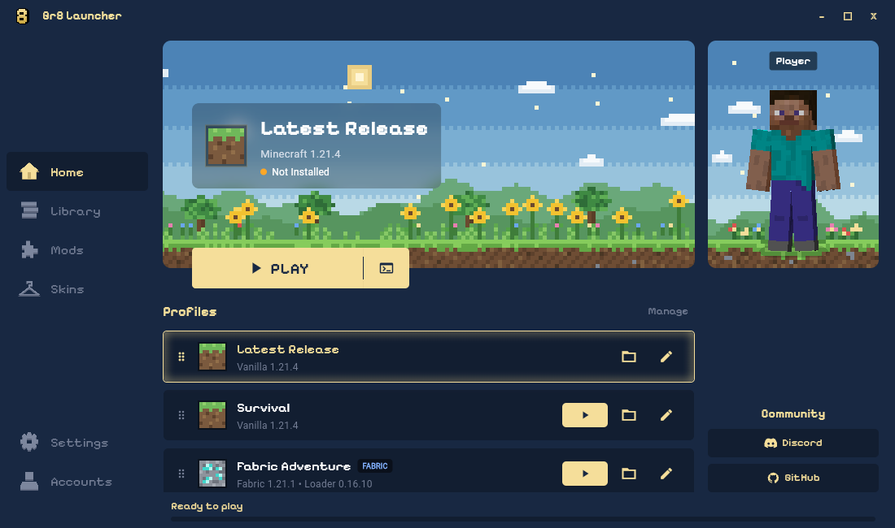

  
  <h1>Gr8 Launcher · Minecraft Java Edition Launcher</h1>
  
<strong>Your worlds, your profiles, your style.</strong>

  

    
    
    
    
  

  

    <a href="#features">Features</a> ·
    <a href="#download-gr8-launcher">Download</a> ·
    <a href="#run-from-source">Run from source</a> ·
    <a href="#frequently-asked-questions">FAQ</a> ·
    <a href="#contributing-and-community">Community</a>
  

**Gr8 Launcher** is a free, open-source **Minecraft Java Edition launcher** built with Python and [Flet](https://flet.dev/). Install vanilla releases and snapshots, create modded profiles with **Fabric, Forge, NeoForge, or Quilt**, and sync **Ely.by skins** from a Minecraft-inspired desktop interface.

## Launcher preview

<em>Automatically captured from the latest successful main build with example profiles. Each release includes its own screenshot in the release notes. <a href="docs/screenshots/gr8-launcher-home.png">View the bundled preview.</a></em>

## Features

| Feature | What you can do |
| --- | --- |
| **Minecraft versions and mod loaders** | Install and launch vanilla releases, snapshots, Fabric, Forge, NeoForge, and Quilt. Use the latest-release shortcut or pin a profile to a specific version. |
| **Profiles and instances** | Keep game folders separate, customize icons, reorder profiles, and import installations from the official Minecraft launcher or discover local instances while preserving version pins and game folders. |
| **Ely.by accounts and skins** | Sign in to Ely.by, sync your skin, rotate Classic/Steve and Slim/Alex previews, and reuse cached skins. A bundled Java skin bridge applies custom skins in-game. |
| **Java and performance settings** | Choose a Java executable, adjust RAM within detected system limits, set profile JVM arguments, and configure game resolution, fullscreen, and launcher behavior. |
| **Download progress and game logs** | Follow installation progress and download speed, cancel downloads, and inspect captured game output from the launcher. Windows launches avoid an extra Java console window. |
| **Offline play** | Launch previously installed versions, reuse cached skin previews, and browse local profiles with automatic connection detection. |
| **[Discord Rich Presence](docs/discord-presence.md)** | Show your current launcher page or the Minecraft version and mod loader you are playing, with your skin face, elapsed time, and an on/off switch in Settings. |
| **Minecraft-inspired design** | Enjoy a dark blue and warm gold interface, pixel fonts, animated navigation, and a home-screen player model with optional cursor-following head movement. |

## Download Gr8 Launcher

**[Download the latest release →](https://github.com/jaydeeppatil23/Gr8Launcher/releases/latest)**

Windows x64 release builds support a **portable ZIP** and a **Windows installer (`*-setup.exe`)**. Extract the ZIP and run `Gr8Launcher.exe`, or run the installer. You do not need Python for the packaged build; Minecraft still needs a Java runtime appropriate for the version you want to play.

Visit [all releases and changelogs](https://github.com/jaydeeppatil23/Gr8Launcher/releases) for earlier builds and release notes. To try the current source interface, follow the setup below.

For local packages and automated GitHub releases, see the [Windows build and release guide](docs/releasing.md).

## Run from source

### Requirements

- **Python 3.10 or newer**
- **Java** compatible with your chosen Minecraft version; common versions require Java 8, 17, or 21, and newer releases may require a newer runtime
- **Git** to clone the repository

### Clone the repository

~~~bash
git clone https://github.com/jaydeeppatil23/Gr8Launcher.git
cd Gr8Launcher
~~~

### Install dependencies and start

Use a virtual environment to keep the launcher's dependencies together. The commands below use its Python executable directly, so activation is optional.

**Windows (PowerShell)**

~~~powershell
py -3 -m venv .venv
.\.venv\Scripts\python.exe -m pip install --upgrade pip
.\.venv\Scripts\python.exe -m pip install -r requirements.txt
.\.venv\Scripts\python.exe main.py
~~~

**macOS / Linux**

~~~bash
python3 -m venv .venv
.venv/bin/python -m pip install --upgrade pip
.venv/bin/python -m pip install -r requirements.txt
.venv/bin/python main.py
~~~

### Launch your first Minecraft profile

1. Choose an **offline username** or sign in with an **Ely.by account**, the current account options.
2. Select the latest release, or open **Library → New Profile** to choose a Minecraft version and mod loader.
3. In **Settings → Java & Memory**, select the appropriate Java runtime and RAM allocation.
4. Launch the profile. Keep an internet connection available for the first installation so game files, libraries, and assets can download.

Existing official launcher profiles and locally discovered instances are imported automatically.

## Frequently asked questions

### Does Gr8 Launcher support Fabric, Forge, NeoForge, and Quilt?

Yes. Choose the loader and a compatible Minecraft version when creating a profile. For mods, use the profile's **Open Game Folder** action and place compatible `.jar` files in its `mods` folder. The in-app **Mods manager is coming soon**.

### How do custom Minecraft skins work?

Sign in with an [Ely.by account](https://ely.by/), change your skin through Ely.by, and refresh the preview in the **Skins** tab. The launcher caches skins locally and includes a Java companion for applying them in-game. Offline username accounts use the default Steve/Alex skins.

### Can I play Minecraft offline?

Yes, when the selected version and its required game files are already installed and a compatible Java runtime is available. Installing new versions or mod loaders and signing in to Ely.by require an internet connection.

### Where are launcher settings, profiles, and cached skins stored?

Gr8 Launcher stores its data in a `gr8launcher` folder inside the default Minecraft directory:

| Operating system | Launcher data folder |
| --- | --- |
| Windows | `%APPDATA%\.minecraft\gr8launcher` |
| macOS | `~/Library/Application Support/minecraft/gr8launcher` |
| Linux | `~/.minecraft/gr8launcher` |

Separate game instances live in the Minecraft directory's `instances` folder unless a profile uses an existing game folder. Legacy launcher data from the project's `.data` folder is migrated automatically.

## Project structure

Explore the Python modules and bundled assets

~~~text
Gr8Launcher/
├── main.py                # Application entry point and page orchestration
├── launcher.py            # Minecraft installation, verification, and launch
├── launcher_services.py   # Connectivity, local discovery, and game logs
├── storage.py             # Persistent settings, accounts, and profiles
├── state.py               # Shared runtime state
├── profile_creation.py    # Profile creation and instance folder handling
├── ely_auth.py            # Ely.by authentication
├── credential_store.py    # Native credential storage and session fallback
├── skins.py               # Skin caching, rendering, and Java companion setup
├── skin_viewer.py         # Interactive player skin rendering and movement
├── home_skin_viewer.py    # Home-screen player model and head tracking
├── ui_profiles.py         # Profile cards and ordering
├── ui_dialogs.py          # Profile dialogs
├── ui_motion.py           # Navigation and entrance animations
├── .assets/               # Fonts, icons, banners, and default skins
├── docs/screenshots/      # Bundled launcher preview for offline viewing
├── tools/                 # Build, release, and Java skin bridge utilities
├── temp/                  # AI tests and local scratch work
└── requirements.txt       # Python dependencies
~~~

Keep all test scripts, validation scripts, and scratch output local in the
ignored `temp/` directory. They are not included in a clone or required by the
GitHub build. If you have these local test files, run them from the project root
after installing the build dependencies:

~~~powershell
python -B -m unittest temp.test_release_plan temp.test_release_tag temp.test_publish_screenshot temp.test_ui_toasts
~~~

## Contributing and community

Bug reports, improvements, and documentation contributions are welcome. [Open an issue](https://github.com/jaydeeppatil23/Gr8Launcher/issues) with your launcher version, operating system, Minecraft version, mod loader, and relevant logs, or [submit a pull request](https://github.com/jaydeeppatil23/Gr8Launcher/pulls).

Join the [Gr8 community on Discord](https://dsc.gg/_gr8) to discuss the launcher and share feedback.

## License

Gr8 Launcher is licensed under the [GNU General Public License v3.0](LICENSE).

*Not an official Minecraft product. Not approved by or associated with Mojang or Microsoft.*
